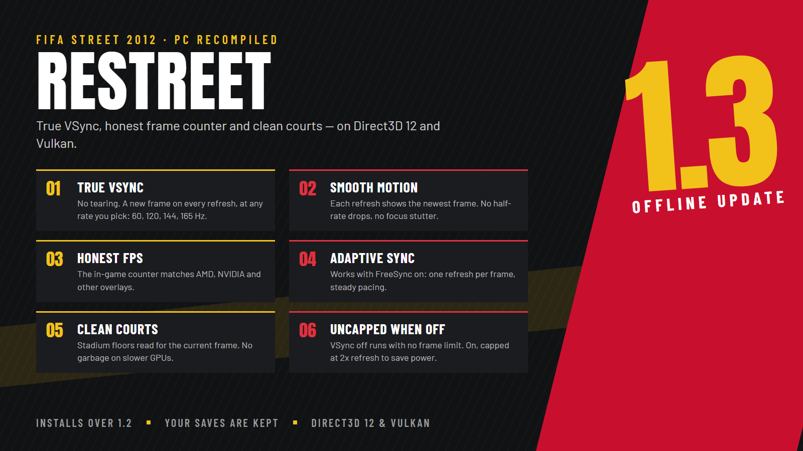

# ReStreet - FIFA Street 2012 Recompiled v1.3

True VSync on Direct3D 12 and Vulkan, an FPS counter that matches GPU overlays, and clean stadium floors on every graphics card. This version is offline only.

## New in v1.3

- **True VSync.** With VSync on, the screen shows a new frame on every refresh, at whatever refresh rate you pick in the launcher (60, 120, 144, 165 Hz and beyond), with no tearing. Each refresh shows the game's newest frame: no half-rate drops, uneven pacing or stutter when the game window has focus. Same on Direct3D 12 and Vulkan.
- **Works with Adaptive Sync / FreeSync.** Frames are handed to the display on an even clock, so the monitor refreshes once per frame instead of holding frames for 2 or 3 refreshes.
- **Honest FPS counter.** With VSync on, the in-game counter counts the frames that reach the screen, the same number AMD, NVIDIA and other overlays show.
- **VSync off = no frame limit.** With VSync on, the game is capped at twice the refresh rate so a fresh frame is always ready without wasting power.
- **The launcher's refresh rate change sticks** while the game is in front, and the refresh rate saved in Windows is restored when the game closes.

## Fixed

- **Graphical garbage on some court floors** on slower graphics cards: the floor data is always read for the current frame.
- **A crash when opening some main menu options** with Direct3D 12.
- **Smoother render-to-texture images** at higher internal resolutions (for example the 3D portraits the game draws for players without a photo).
- **Intro and cutscene videos** play at the correct speed with clean sound, with VSync on or off.

## Known limitations

- With VSync on, the game cannot show more frames than it produces: if a scene runs below your refresh rate, some frames stay on screen for two refreshes. 60 Hz is the safest choice for a perfectly steady match.
- The 3D portraits of players without a photo (generated World Tour squad players, created players) are drawn small by the game and look soft on large screens. This is how the game draws them.

## How to install

1. Download `FifaStreetSetup.exe` and check its SHA-256 against the value on the release page.
2. Run it, choose your own FIFA Street (2012) Xbox 360 ISO and an empty folder, and press **INSTALL ReStreet**.
3. Press **OPEN LAUNCHER**, then **PLAY**.

To update, select the folder that contains `Game` and `GameData`. No ISO is needed.

## Requirements (estimates)

Windows 10 or 11 (64-bit), a CPU with SSSE3, a Direct3D 12 or Vulkan GPU (about GTX 900 / RX 400 or newer), 8 GB RAM and 12 GB of free disk space. On a weaker PC use the Performance profile. See [STATUS.md](STATUS.md) for what was and was not tested.

## Notes

- Performance depends on your hardware and drivers; the profiles are starting points, not guarantees.
- The installer includes generated game binaries. The project's MIT licence does not establish the right to redistribute them, and no legal clearance is claimed.
- The Mods logo patch is derived from the game's own art.
- This is an unofficial community project, with no affiliation to EA, Microsoft or Xbox.
